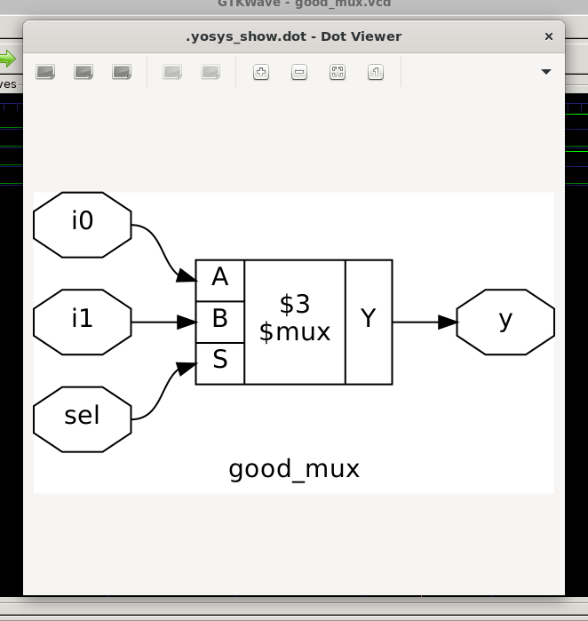
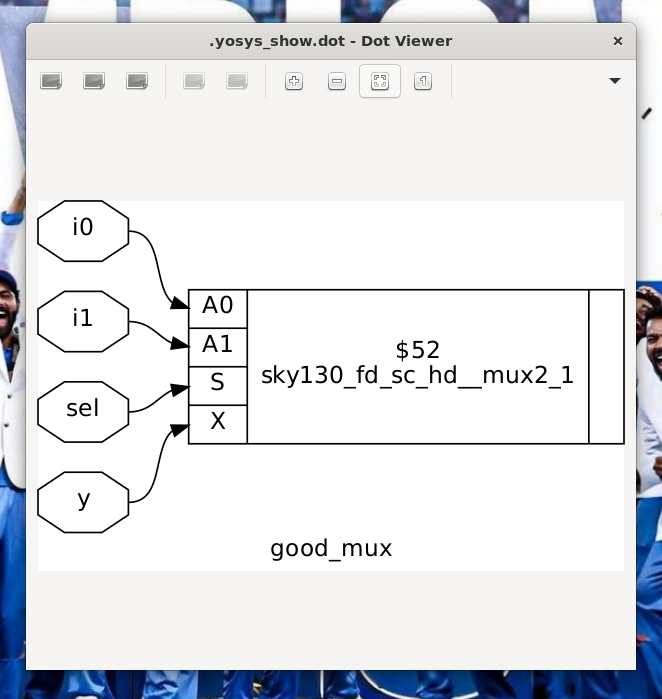

# 02. Logic Synthesis & Technology Mapping (SkyWater 130nm)

## 📌 Module Overview
This module details the logic synthesis, Boolean optimization, and technology mapping of the 2:1 Multiplexer targeting the **SkyWater 130nm Process Design Kit (`sky130_fd_sc_hd`)** using **Yosys** and **Berkeley ABC**.

---

## ⚙️ Synthesis Pipeline & Methodology

```text
       good_mux.v (RTL)
              │
              ▼
    [ Yosys: read_verilog ]
              │
              ▼
   [ hierarchy -check -top ]   ── Verifies top-level interface
              │
              ▼
         [ proc; opt ]         ── Converts processes to generic $mux
              │
              ▼
       [ techmap; opt ]        ── Decomposes coarse cells into Boolean logic
              │
              ▼
    [ ABC: abc -liberty ]      ── Maps Boolean network to Sky130 standard cells
              │
              ▼
       good_mux_synth.v        ── Silicon Gate-Level Netlist
```

---

## 📜 Automated Yosys Script (`scripts/synth.ys`)

```tcl
# Read design
read_verilog src/good_mux.v

# Elaborate hierarchy
hierarchy -check -top good_mux

# Translate processes to netlist primitives
proc; opt

# Decompose coarse-grain primitives into fine-grain logic
techmap; opt

# Map to SkyWater 130nm High-Density Library
abc -liberty /home/aravi/.ciel/ciel/sky130/versions/0fe599b2afb6708d281543108caf8310912f54af/sky130A/libs.ref/sky130_fd_sc_hd/lib/sky130_fd_sc_hd__tt_025C_1v80.lib

# Clean up unused nets and print statistics
clean
stat -liberty /home/aravi/.ciel/ciel/sky130/versions/0fe599b2afb6708d281543108caf8310912f54af/sky130A/libs.ref/sky130_fd_sc_hd/lib/sky130_fd_sc_hd__tt_025C_1v80.lib

# Write gate-level netlist
write_verilog -noattr netlist/good_mux_synth.v
```

---

## 🔬 Gate-Level Netlist Output (`netlist/good_mux_synth.v`)

```verilog
/* Generated by Yosys 0.9 */

module good_mux(i0, i1, sel, y);
  input i0;
  input i1;
  input sel;
  output y;

  sky130_fd_sc_hd__mux2_1 _0_ (
    .A0(i0),
    .A1(i1),
    .S(sel),
    .X(y)
  );
endmodule
```

### 🧠 Cell Anatomy: `sky130_fd_sc_hd__mux2_1`
* **`sky130`**: 130nm bulk CMOS fabrication process.
* **`fd`**: SkyWater Foundry Qualified.
* **`sc`**: Digital Standard Cell.
* **`hd`**: High-Density library architecture (optimized for minimal silicon area).
* **`mux2`**: 2-to-1 Multiplexer logic function.
* **`_1`**: Output Drive Strength 1 ($1\times$ transistor sizing).

---

## 📊 Synthesis Statistics

| Metric | Result | Industry Interpretation |
| :--- | :--- | :--- |
| **Total Standard Cells** | **1** | Mapped directly to a dedicated silicon MUX standard cell. |
| **Cell Type** | `sky130_fd_sc_hd__mux2_1` | High-density 2:1 multiplexer. |
| **Sequential Elements** | **0** | Pure combinational logic (no latch or flip-flop overhead). |
| **Input / Output Ports** | 3 Inputs (`i0`, `i1`, `sel`), 1 Output (`y`) | Fully bound and routed. |

---

## 💡 Engineering Case Study: The ABC Technology Mapping Edge-Case

### The Challenge:
During initial synthesis attempts without `techmap`, invoking `abc -liberty ...` directly after `proc; opt` yielded the following compiler warning:
```text
Extracted 0 gates and 0 wires to a netlist network with 0 inputs and 0 outputs.
Don't call ABC as there is nothing to map.
```

### The Root Cause:
The `proc` pass generates coarse-grained internal macro-blocks (such as `$mux`, `$add`). The **ABC** optimization engine exclusively accepts bit-level Boolean networks (And-Inverter Graphs). Because the high-level `$mux` block was not yet factored into Boolean logic gates, ABC saw zero eligible nodes in the network.

### The Solution:
Injecting the **`techmap`** pass immediately before ABC decomposes all high-level internal abstractions into basic Boolean gates. Once decomposed, ABC successfully evaluated the Boolean network against the SkyWater 130nm Liberty timing library and optimized the logic into a single **`sky130_fd_sc_hd__mux2_1`** cell.

---

## 🎨 Schematic Comparison: RTL vs. Silicon Mapped

### 1. Pre-Mapping Generic Schematic (Yosys `$mux`)

*Generic technology-independent 2:1 multiplexer with inputs `A`, `B`, `S` and output `Y`.*

### 2. Post-Mapping Silicon Standard Cell Schematic (`sky130_fd_sc_hd__mux2_1`)

*Physical SkyWater 130nm standard cell with foundry pins `A0`, `A1`, `S`, and `X`.*
