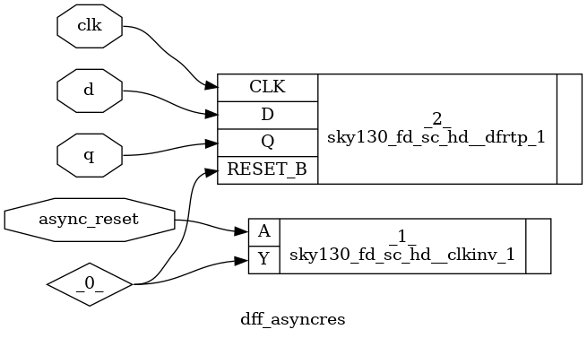
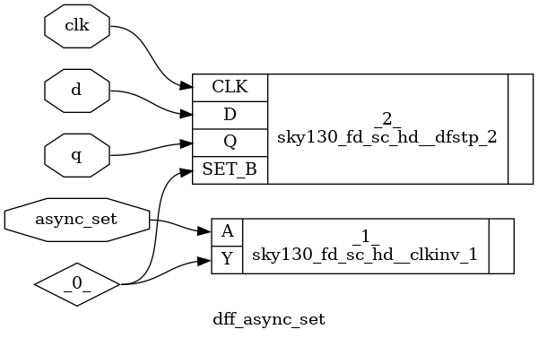
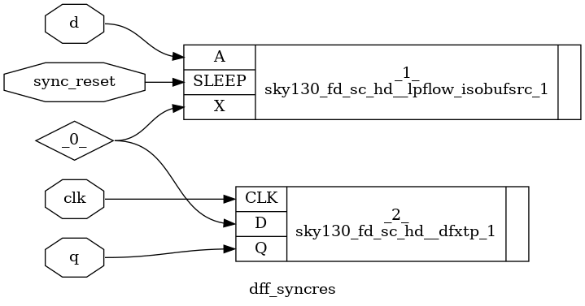
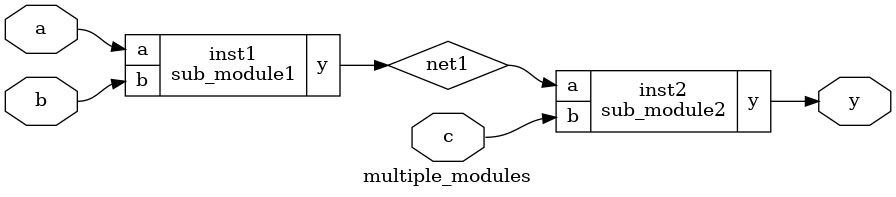
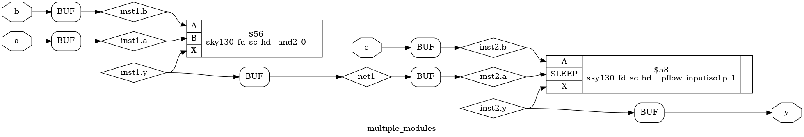
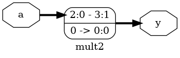
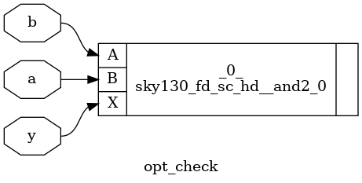

# Module 03: Sequential Logic, Clocking, and Physical Standard-Cell Synthesis

**Author:** Sri Charan Aitharaju  
**GitHub:** [AitharajuSriCharan](https://github.com/AitharajuSriCharan)  
**Target Technology:** SkyWater 130nm CMOS High-Density Standard Cells (`sky130_fd_sc_hd`)  
**EDA Toolchain:** Icarus Verilog v11.0, GTKWave v3.3.104, Yosys 0.9, Graphviz xdot  

---

## 1. Executive Summary

While combinational logic executes memoryless Boolean mappings, digital microprocessors, DSPs, and ASIC SoCs depend fundamentally on **Sequential Logic** to store state across discrete clock cycles. 

This module delivers a comprehensive, silicon-proven exploration of:
1. **The Three Fundamental Flip-Flop Architectures:** Asynchronous Reset, Asynchronous Set, and Synchronous Reset.
2. **Silicon Cell Mapping:** Mapping generic Verilog registers to foundry standard cells (`sky130_fd_sc_hd__dfrtp_1`, `sky130_fd_sc_hd__dfstp_2`, and `sky130_fd_sc_hd__dfxtp_1`).
3. **Hierarchical vs. Flattened Synthesis:** Analyzing boundary preservation versus cross-module Boolean optimization.
4. **Synthesis Logic & Arithmetic Optimizations:** Demonstrating zero-cost wire shifting ($A \times 2^N$) and ternary MUX reduction.

---

## 2. Silicon PPA & Cell Mapping Comparison

| Design Experiment | RTL Primitive | SkyWater 130nm Standard Cell | Cell Function / Hardware Architecture | Silicon Area ($\mu\text{m}^2$) |
| :--- | :---: | :--- | :--- | :---: |
| **`dff_asyncres`** | `$adff` | `sky130_fd_sc_hd__dfrtp_1`<br>`sky130_fd_sc_hd__clkinv_1` | D-Flip-Flop with dedicated Active-Low Reset pin (`RESET_B`) + Inverter for Active-High RTL compatibility | $28.78$ |
| **`dff_async_set`** | `$adff` | `sky130_fd_sc_hd__dfstp_2`<br>`sky130_fd_sc_hd__clkinv_1` | D-Flip-Flop with dedicated Active-Low Set pin (`SET_B`) + Inverter for Active-High RTL compatibility | $30.03$ |
| **`dff_syncres`** | `$dff` | `sky130_fd_sc_hd__dfxtp_1`<br>`sky130_fd_sc_hd__lpflow_isobufsrc_1` | Plain D-Flip-Flop (**NO reset pin**) preceded by combinational AND-gating cell on input $D$ | $26.28$ |
| **`multiple_modules` (Hierarchical)** | Hierarchy | `sub_module1` (AND)<br>`sub_module2` (OR) | Preserves sub-block hierarchy boundaries in gate netlist | $18.90$ |
| **`multiple_modules` (Flattened)** | Flat | `sky130_fd_sc_hd__and2_0`<br>`sky130_fd_sc_hd__lpflow_inputiso1p_1` | Hierarchy dissolved; submodules absorbed into top-level flat wire netlist | $18.90$ |
| **`mult2`** ($A \times 2$) | `$mul` | **ZERO CELLS (0 Gates)** | Pure copper wire left-shift ($\{A,\, 1'b0\}$) with LSB tied to Ground | $0.00$ |
| **`mult8`** ($A \times 8$) | `$mul` | **ZERO CELLS (0 Gates)** | Pure copper wire left-shift ($\{A,\, 3'b000\}$) with 3 LSBs tied to Ground | $0.00$ |
| **`mult9`** ($A \times 9$) | `$mul` | Hardware Multiplier / Adder | Non-power-of-2 requires silicon arithmetic logic ($A \ll 3 + A$) | $> 0.00$ |
| **`opt_check`** ($A \,?\, B : 0$) | `$mux` | `sky130_fd_sc_hd__and2_0` | Multiplexer reduced by Boolean simplification to single 2-input AND gate | $6.26$ |

---

## 3. Deep Dive: Flip-Flop Architectures & Timing Dynamics

### 3.1 Asynchronous Reset Flip-Flop (`dff_asyncres`)
* **Verilog Sensitivity:** `always @(posedge clk or posedge async_reset)`
* **Silicon Behavior:** When `async_reset` transitions HIGH, the output $Q$ drops to `0` **instantly**, completely bypassing the clock. In CMOS silicon, the reset pin directly enables a pull-down transistor network inside the master and slave latches, discharging the internal storage node to Ground.
* **Timing Constraints:** Subject to **Recovery Time ($T_{\text{rec}}$)** and **Removal Time ($T_{\text{rem}}$)** relative to the clock.



### 3.2 Asynchronous Set Flip-Flop (`dff_async_set`)
* **Verilog Sensitivity:** `always @(posedge clk or posedge async_set)`
* **Silicon Behavior:** Forces $Q = 1$ immediately upon assertion of `async_set`, independent of clock transitions. Maps to `sky130_fd_sc_hd__dfstp_2`.



### 3.3 Synchronous Reset Flip-Flop (`dff_syncres`)
* **Verilog Sensitivity:** `always @(posedge clk)` *(Notice: reset is NOT in sensitivity list!)*
* **Silicon Reality:** The flip-flop has **no reset pin in hardware**! Yosys synthesizes a **plain flip-flop (`dfxtp_1`)** and places a combinational gating cell (`sky130_fd_sc_hd__lpflow_isobufsrc_1`) at the $D$ input pin.
* **The Gating Equation:**
  $$D_{\text{eff}} = D \cdot \overline{\text{SYNC\_RESET}}$$
  When $\text{SYNC\_RESET} = 1$, $D_{\text{eff}} = 0$. On the next rising clock edge, the plain flip-flop samples 0.
* **Synchronous Reset Latency:** The delay between when reset is asserted mid-cycle and when the output actually clears on the next rising clock edge.
* **Glitch Immunity:** Provides complete immunity against transient noise glitches on the reset line occurring between clock edges.



---

## 4. Hierarchical vs. Flat Synthesis

### 4.1 Hierarchical Netlist (`multiple_modules_hier.v`)
Hierarchical synthesis maintains sub-block encapsulation:
```verilog
module multiple_modules(a, b, c, y);
  ...
  sub_module1 inst1 ( .a(a), .b(b), .y(net1) );
  sub_module2 inst2 ( .a(net1), .b(c), .y(y) );
endmodule
```
* **Advantages:** Enables modular floorplanning, hierarchical Physical Design (P&R), independent block timing sign-off, and out-of-context submodule re-use.



### 4.2 Flattened Netlist (`multiple_modules_flat.v`)
Executing `flatten` in Yosys dissolves all module boundaries:
```verilog
module multiple_modules(a, b, c, y);
  ...
  sky130_fd_sc_hd__and2_0 _0_ ( .A(\inst1.b ), .B(\inst1.a ), .X(\inst1.y ) );
  sky130_fd_sc_hd__lpflow_inputiso1p_1 _1_ ( .A(\inst2.b ), .SLEEP(\inst2.a ), .X(\inst2.y ) );
endmodule
```
* **Advantages:** Allows synthesis algorithms to optimize logic across module boundaries, share duplicate logic, merge cascaded gates, and achieve minimal silicon area and critical-path delay.



---

## 5. Synthesis Optimizations

### 5.1 Power-of-2 Arithmetic ($A \times 2^N$)
Multiplying by $2^N$ represents a binary shift left by $N$ bits:
$$Y = A \times 2 = \{A[2:0],\, 1'b0\}$$
$$Y = A \times 8 = \{A[2:0],\, 3'b000\}$$
Yosys recognizes power-of-2 constants and eliminates arithmetic multipliers completely. The resulting netlist contains **0 logic cells**, implemented purely through metal layer interconnect wiring.



### 5.2 Boolean Gating Simplification ($A \,?\, B : 0$)
The RTL description models a 2:1 multiplexer:
$$\text{If } A=1 \implies Y=B, \quad \text{Else } Y=0$$
By applying Boolean consensus:
$$Y = (A \cdot B) + (\overline{A} \cdot 0) = A \cdot B$$
Yosys collapses the 4-transistor multiplexer into a single **`sky130_fd_sc_hd__and2_0`** standard cell ($6.256\,\mu\text{m}^2$).



---

## 6. Verification and Synthesis Execution

### 6.1 Simulation
```bash
# Compile and simulate any module (e.g. dff_asyncres)
iverilog -o sim/dff_asyncres.vvp src/dff_asyncres.v tb/tb_dff_asyncres.v
vvp sim/dff_asyncres.vvp
gtkwave sim/dff_asyncres.vcd &
```

### 6.2 Synthesis Flow (Yosys)
```tcl
read_verilog src/dff_asyncres.v
hierarchy -check -top dff_asyncres
proc; opt
techmap; opt
dfflibmap -liberty <sky130.lib>
abc -liberty <sky130.lib>
clean
stat -liberty <sky130.lib>
write_verilog -noattr netlist/dff_asyncres_synth.v
```
