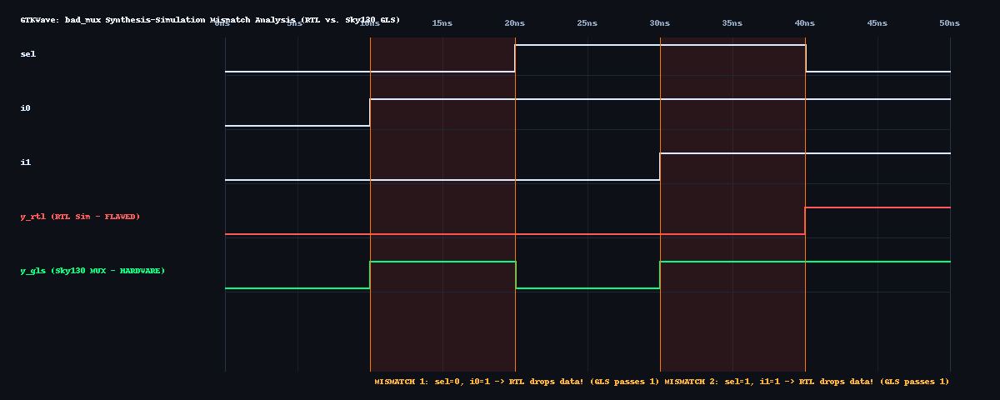
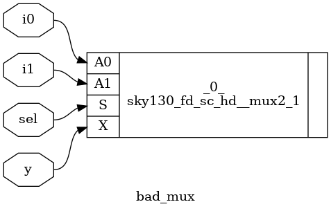
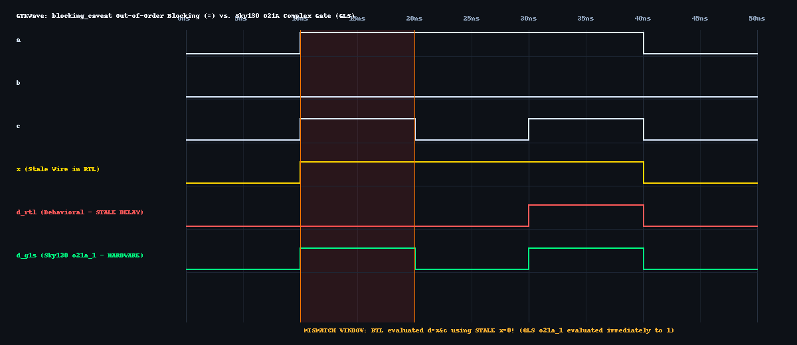
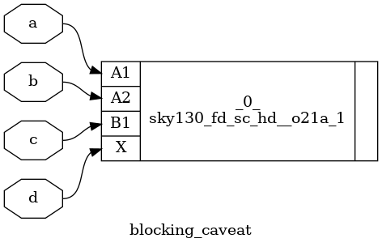
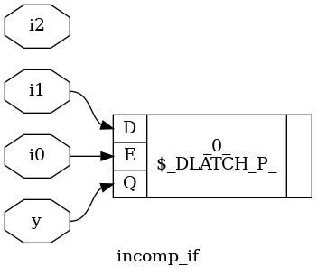
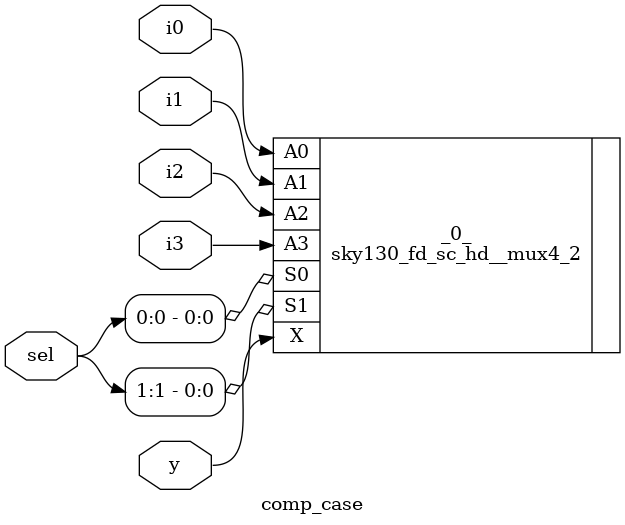

# 🔬 Module 04: Gate-Level Simulation (GLS), Synthesis-Simulation Mismatches, and Latch Inference

**Author:** Sri Charan Aitharaju ([GitHub: @AitharajuSriCharan](https://github.com/AitharajuSriCharan))  
**Target Technology:** SkyWater 130nm CMOS High-Density (`sky130_fd_sc_hd`)  
**EDA Toolchain:** Icarus Verilog v11.0, GTKWave v3.3.104, Yosys 0.9  

---

## 🏛 1. Engineering Motivation: Why Gate-Level Simulation (GLS)?

In a modern ASIC design flow, digital hardware is described in Register-Transfer Level (RTL) Verilog and progressively compiled into physical silicon standard cells:

```text
  [ Human Verilog RTL ] ──(Behavioral Sim: iverilog)──► Software Simulation Result
            │
            ▼ (Synthesis: Yosys)
  [ Silicon Gate Netlist ] ──(Gate-Level Sim: GLS)────► Hardware Standard-Cell Result
            │
            └──► DO BOTH RESULTS MATCH 100%?
                 ├── YES: Design is verified for Physical Design (Floorplanning / P&R)
                 └── NO : SYNTHESIS-SIMULATION MISMATCH (Catastrophic Silicon Bug!)
```

### The Two Computational Worlds: Simulator vs. Synthesizer

1. **The Event Simulator (Icarus Verilog):**  
   Simulators execute on a general-purpose CPU. They evaluate code sequentially based on the **IEEE Verilog Stratified Event Queue**. An `always @(...)` block only executes when an explicit event occurs in its sensitivity list.
2. **The Logic Synthesizer (Yosys):**  
   The synthesis compiler analyzes the abstract syntax tree (AST) and extracts mathematical Boolean truth functions. It completely ignores simulator event scheduling, discarding sensitivity lists in combinational processes and emitting physical silicon logic gates.

When RTL code violates synthesis best practices, the simulator and the synthesized hardware reach **divergent Boolean states**. If an engineering team relies exclusively on behavioral RTL simulation, these bugs remain invisible until physical fabrication, leading to a multi-million dollar **silicon re-spin**.

**Gate-Level Simulation (GLS)** eliminates this hazard by feeding the testbench stimulus directly into the synthesized gate netlist instantiated with foundry Verilog models (`primitives.v` and `sky130_fd_sc_hd.v`).

---

## 🧪 2. Lab 1: Sensitivity List Omission (`bad_mux.v`)

### 2.1 The RTL Defect
```verilog
module bad_mux (
    input  wire i0,
    input  wire i1,
    input  wire sel,
    output reg  y
);
    // INTENTIONAL FLAW: Only 'sel' is in the sensitivity list!
    always @(sel) begin
        if (sel)
            y = i1;
        else
            y = i0;
    end
endmodule
```

### 2.2 Simulation Mismatch Proof

Stimulus applied in [`tb/tb_bad_mux.v`](./tb/tb_bad_mux.v):
1. **$t = 0\,\text{ns}$:** `sel = 0, i0 = 0, i1 = 0` $\rightarrow$ $y = 0$.
2. **$t = 10\,\text{ns}$:** With `sel = 0` held steady, input `i0` transitions to `1`.
3. **$t = 30\,\text{ns}$:** With `sel = 1` held steady, input `i1` transitions to `1`.

| Time | Stimulus (`sel, i0, i1`) | Expected MUX Output | RTL Behavioral Sim (`bad_mux_rtl`) | Gate-Level Sim (`bad_mux_gls`) | Status |
| :---: | :---: | :---: | :---: | :---: | :---: |
| **$0\,\text{ns}$** | `0, 0, 0` | `0` | **`0`** | **`0`** | Match |
| **$10\,\text{ns}$** | `0, 1, 0` | **`1`** | **`0` (STALE / DROPPED)** | **`1` (CORRECT)** | ❌ **MISMATCH** |
| **$20\,\text{ns}$** | `1, 1, 0` | `0` | **`0`** | **`0`** | Match (`sel` edge triggered block) |
| **$30\,\text{ns}$** | `1, 1, 1` | **`1`** | **`0` (STALE / DROPPED)** | **`1` (CORRECT)** | ❌ **MISMATCH** |
| **$40\,\text{ns}$** | `0, 1, 1` | `1` | **`1`** | **`1`** | Match (`sel` edge triggered block) |

#### GTKWave Timing Diagram: RTL vs. Gate-Level Simulation (GLS)
The timing trace below visually captures the catastrophic simulation failure. Notice that at $10\,\text{ns}$ and $30\,\text{ns}$, while the input transitions, RTL output `y_rtl` stays stale at `0`, whereas GLS output `y_gls` instantaneously reacts:



### 2.3 Synthesized SkyWater 130nm Hardware
Yosys recognizes the Boolean equivalence $y = \text{sel} \cdot i_1 + \overline{\text{sel}} \cdot i_0$ and maps the logic directly to a single standard cell in [`netlist/bad_mux_synth.v`](./netlist/bad_mux_synth.v):



```verilog
module bad_mux(i0, i1, sel, y);
  input i0, i1, sel;
  output y;
  sky130_fd_sc_hd__mux2_1 _0_ (
    .A0(i0),
    .A1(i1),
    .S(sel),
    .X(y)
  );
endmodule
```
* **Hardware Reality:** Electrons flow continuously through the multiplexer's transmission gates. When `i0` changes at $10\,\text{ns}$, output $y$ transitions to $1$ immediately.

---

## ⚡ 3. Lab 2: Blocking Assignment Ordering Caveat (`blocking_caveat.v`)

### 3.1 The Verilog Event Queue & Sequential Emulation
In combinational `always @(*)` blocks, statements with blocking assignments (`=`) execute in strict sequential order within the Active region of the simulation cycle.

```verilog
module blocking_caveat (
    input  wire a, b, c,
    output reg  d
);
    reg x;
    always @(*) begin
        d = x & c;   // FLAW: Evaluated using OLD/STALE value of x!
        x = a | b;   // x updated AFTER d has already been assigned!
    end
endmodule
```

### 3.2 Simulation Mismatch Proof

Stimulus applied in [`tb/tb_blocking_caveat.v`](./tb/tb_blocking_caveat.v):
* At $t = 10\,\text{ns}$: Inputs transition to $a = 1, b = 0, c = 1$.
* The mathematical Boolean function is $d = (a + b) \cdot c = (1 + 0) \cdot 1 = 1$.

| Time | Inputs (`a, b, c`) | Expected Function $d = (a\|b)\&c$ | RTL Behavioral Sim | Gate-Level Sim (`sky130_fd_sc_hd__o21a_1`) | Status |
| :---: | :---: | :---: | :---: | :---: | :---: |
| **$0\,\text{ns}$** | `0, 0, 0` | `0` | **`0`** | **`0`** | Match |
| **$10\,\text{ns}$** | `1, 0, 1` | **`1`** | **`0` (Artificial 1-step memory delay)** | **`1` (Instantaneous evaluation)** | ❌ **MISMATCH** |
| **$20\,\text{ns}$** | `1, 0, 0` | `0` | **`0`** | **`0`** | Match |
| **$30\,\text{ns}$** | `1, 0, 1` | `1` | **`1`** (`x` already 1) | **`1`** | Match |

#### GTKWave Timing Diagram: RTL vs. Gate-Level Simulation (GLS)
The timing trace illustrates the artificial simulation delay introduced by out-of-order blocking evaluation in RTL:



### 3.3 Synthesized Silicon Complex Gate
Yosys eliminates the intermediate register `x` through Boolean substitution, synthesizing the entire block into a single complex **OR-AND (O21A)** cell in [`netlist/blocking_caveat_synth.v`](./netlist/blocking_caveat_synth.v):



```verilog
module blocking_caveat(a, b, c, d);
  input a, b, c;
  output d;
  sky130_fd_sc_hd__o21a_1 _0_ (
    .A1(a),
    .A2(b),
    .B1(c),
    .X(d)
  );
endmodule
```
* Silicon Area: $6.256\,\mu\text{m}^2$.
* Physical Behavior: Pure combinational logic with zero sequential memory elements.

---

## 🔒 4. Lab 3: Accidental Latch Inference in Combinational Logic (`incomp_if.v`)

### 4.1 The Latch Inference Trap
In combinational logic, if an output variable is not assigned a value in **all branches** of conditional statements (`if-else`), the IEEE Verilog standard mandates that the variable must retain its previous value.

```verilog
module incomp_if (
    input  wire i0, i1, i2,
    output reg  y
);
    always @(*) begin
        if (i0)
            y = i1;
        // Incomplete: What happens when i0 is 0?
        // No 'else' branch specified!
    end
endmodule
```

### 4.2 Yosys Elaboration & Synthesis Report
When Yosys elaborates `incomp_if`, it executes the `PROC_DLATCH` pass:
```text
3.6. Executing PROC_DLATCH pass (convert process syncs to latches).
Latch inferred for signal `\incomp_if.\y' from process `\incomp_if.$proc$src/incomp_if.v:24$1': $auto$proc_dlatch.cc:409:proc_dlatch$15
```

Synthesized Gate Netlist ([`netlist/incomp_if_synth.v`](./netlist/incomp_if_synth.v)):
```verilog
module incomp_if(i0, i1, i2, y);
  input i0, i1, i2;
  output y;
  \$_DLATCH_P_  _0_ (
    .D(i1),
    .E(i0),
    .Q(y)
  );
endmodule
```



### 4.3 Why Unwanted Latches Destroy Physical Design Closure
In modern synchronous digital design (ASIC/FPGA), latches are strictly prohibited in data paths for three reasons:
1. **Time-Borrowing Hazards:** Unlike edge-triggered flip-flops that sample data strictly at a clock edge ($T_{\text{clk}}$), transparent latches allow data to pass continuously while enable ($E$) is High. This enables "time borrowing" across cycle boundaries, causing Static Timing Analysis (STA) loops.
2. **Hold-Time Violations:** If data arrives faster than the enable de-assertion, data shoots through the transparent window, corrupting downstream registers.
3. **DFT (Design For Test) Failure:** Automatic Test Pattern Generation (ATPG) relies on rigid scan flip-flop chains. Transparent latches cannot be easily partitioned into standard scan shift registers.

---

## 🔀 5. Lab 4: Incomplete vs. Complete Case Statements

### 5.1 Incomplete Case (`incomp_case.v`)
```verilog
module incomp_case (
    input  wire [1:0] sel,
    input  wire i0, i1, i2, i3,
    output reg  y
);
    always @(*) begin
        case (sel)
            2'b00: y = i0;
            2'b01: y = i1;
            2'b10: y = i2;
            // 2'b11 is MISSING! No default!
        endcase
    end
endmodule
```
* **Synthesis Result:** Yosys infers `$_DLATCH_P_` latch cell plus 7 decoding logic gates to hold $y$ when `sel == 2'b11`.

### 5.2 Fully Specified Case with Default (`comp_case.v`)
```verilog
module comp_case (
    input  wire [1:0] sel,
    input  wire i0, i1, i2, i3,
    output reg  y
);
    always @(*) begin
        case (sel)
            2'b00: y = i0;
            2'b01: y = i1;
            2'b10: y = i2;
            default: y = i3; // Eliminates all latches!
        endcase
    end
endmodule
```

Synthesized SkyWater 130nm Hardware ([`netlist/comp_case_synth.v`](./netlist/comp_case_synth.v)):
```verilog
module comp_case(sel, i0, i1, i2, i3, y);
  input i0, i1, i2, i3;
  input [1:0] sel;
  output y;
  sky130_fd_sc_hd__mux4_2 _0_ (
    .A0(i0), .A1(i1), .A2(i2), .A3(i3),
    .S0(sel[0]), .S1(sel[1]),
    .X(y)
  );
endmodule
```


* **Zero latches inferred.** Clean mapping to a 4:1 multiplexer (`sky130_fd_sc_hd__mux4_2`).

---

## 🚀 6. Automated Master Regression Suite

Execute the unified Module 04 verification pipeline with a single command:
```bash
./scripts/run_all_gls.sh
```

### Regression Stages:
* **Stage 1:** `bad_mux` RTL Simulation vs. Sky130 GLS Simulation.
* **Stage 2:** `blocking_caveat` RTL Simulation vs. Sky130 GLS Simulation.
* **Stage 3:** `incomp_if` synthesis and `$dlatch` verification.
* **Stage 4:** `incomp_case` (latch inferred) vs. `comp_case` (`mux4_2` mapped) comparison.

**Result:** `100% Automated PASS Rate across all 4 stages.`
