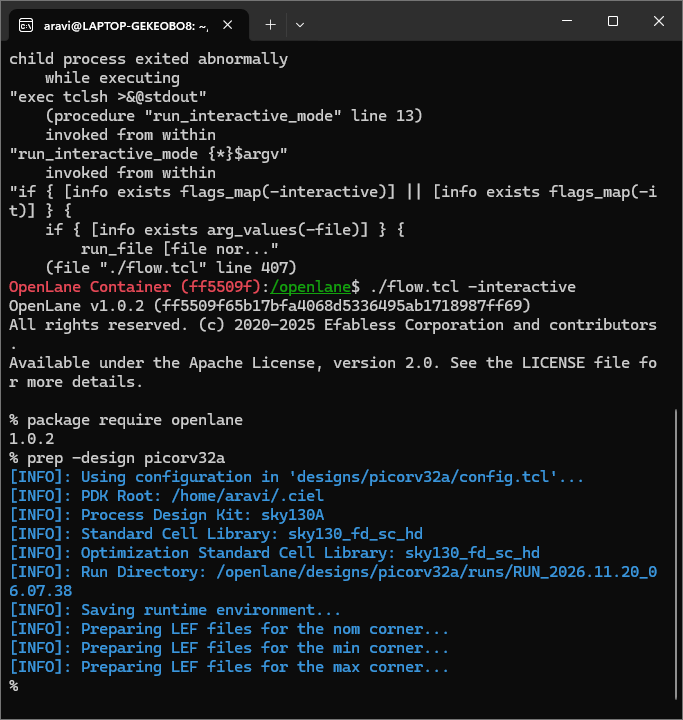
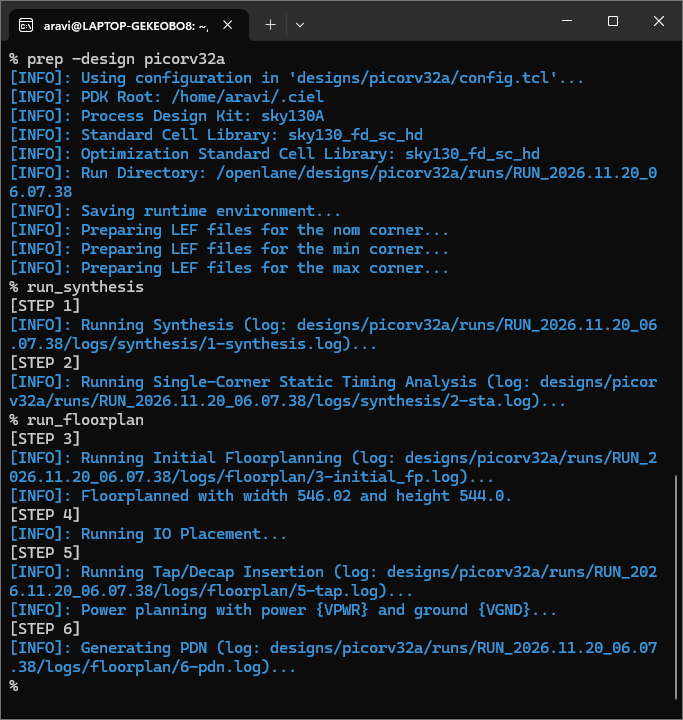
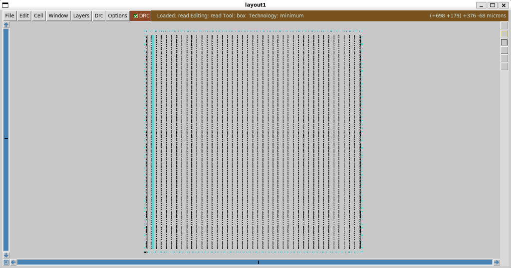
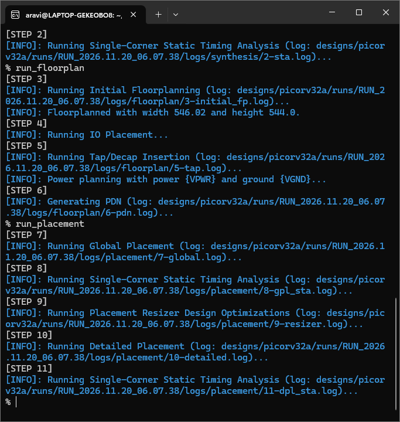
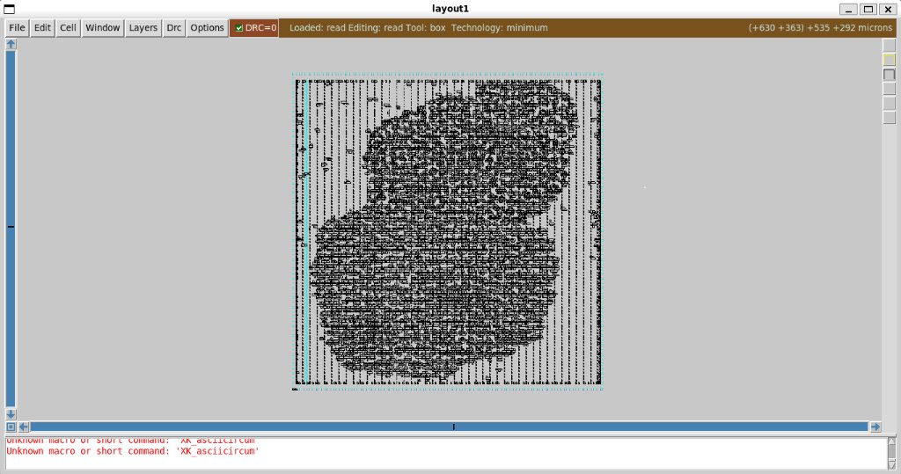
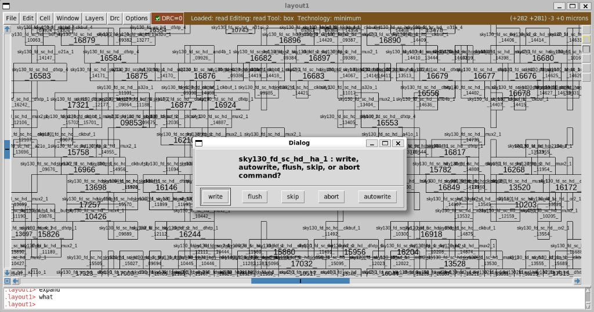
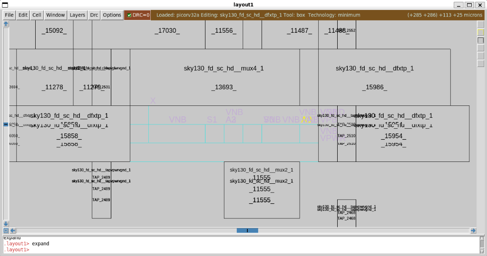

# 🏗️ Module 05: OpenLane Backend Implementation — Synthesis, Floorplanning, and Placement

**Author:** Sri Charan Aitharaju ([GitHub: @AitharajuSriCharan](https://github.com/AitharajuSriCharan))  
**Target Technology:** SkyWater 130nm CMOS High-Density (`sky130_fd_sc_hd`)  
**Design Under Test:** Claire Wolf's PicoRV32 32-bit RISC-V CPU Core (`picorv32a`)  
**EDA Flow & Tools:** OpenLane v1.0.2, Yosys 0.9, Berkeley ABC, OpenROAD (RePLace, OpenDP), OpenSTA, Magic VLSI v8.3  

---

## 🏛 1. Engineering Motivation & Flow Architecture

With RTL design, functional verification, sequential clocking, and Gate-Level Simulation (GLS) completed in Modules 01 through 04, Module 05 marks the beginning of **ASIC Physical Design (Backend Implementation)**. 

In this module, we transition from abstract Boolean netlists to **physical silicon standard-cell layouts** using the production-grade **OpenLane** containerized flow:

```text
[ PicoRV32 Verilog RTL ] ──► [ Yosys + ABC Synthesis ] ──► [ Flop Ratio Calculation (16.58%) ]
                                                                     │
                                                                     ▼
[ Magic DEF Physical Layout ] ◄── [ OpenDP Detailed ] ◄── [ RePLace Global ] ◄── [ Floorplanning & PDN ]
```

---

## 🧪 2. Step-by-Step Implementation & Execution Proofs

### 2.1 OpenLane Interactive Inception & Design Preparation
Unlike automated "black-box" runs, we initialize OpenLane in **Interactive Mode** (`./flow.tcl -interactive`) and load the target SkyWater 130nm PDK:

```tcl
package require openlane
prep -design picorv32a
```



* **PDK Root:** `/home/aravi/.ciel` (SkyWater 130A)
* **Standard Cell Library:** `sky130_fd_sc_hd`
* **Multi-Corner LEF Preparation:** `nom` ($25^\circ\text{C}, 1.80\,\text{V}$), `min` (Fast corner: $-40^\circ\text{C}, 1.98\,\text{V}$), `max` (Slow corner: $125^\circ\text{C}, 1.62\,\text{V}$).
* **Active Run Directory:** `designs/picorv32a/runs/RUN_2026.11.20_06.07.38/`

---

### 2.2 PicoRV32a Logic Synthesis & The Flop Ratio
Executing `run_synthesis` triggers Yosys AST elaboration and ABC technology mapping into `sky130_fd_sc_hd` standard cells.

#### Synthesis Report Metrics ([`reports/1-synthesis.DELAY_0.stat.rpt`](./reports/1-synthesis.DELAY_0.stat.rpt)):
| Metric | Synthesized Quantity | Physical Meaning |
| :--- | :--- | :--- |
| **Total Standard Cells ($N_{\text{Total}}$)** | **`9,624`** | Total CMOS logic gates + flip-flops |
| **Sequential Flip-Flops ($N_{\text{DFF}}$)** | **`1,596`** | D-Flip-Flop registers (`sky130_fd_sc_hd__dfxtp_2`) |
| **Multiplexers** | **`1,891`** | `mux2_2` (1,528) and `mux4_2` (363) |
| **High-Drive Buffers** | **`2,101`** | Signal slew buffers (`buf_1`, `buf_2`) |
| **Standard Cell Area** | **`104,443.92 µm²`** | Active gate silicon footprint |

#### 🧮 Mathematical Derivation of the Flop Ratio:
$$\text{Flop Ratio} = \frac{N_{\text{DFF}}}{N_{\text{Total}}} \times 100\% = \frac{1,596}{9,624} \times 100\% = \mathbf{16.58\%}$$

---

### 2.3 Floorplanning, Core Sizing, and Power Distribution Network (PDN)
Executing `run_floorplan` calculates the physical die area, defines peripheral IO pins, inserts well-tap arrays, places decoupling capacitors, and synthesizes the power rails:



#### Silicon Coordinate Proof ([`results/floorplan/picorv32a.def`]):
* **Die Area:** `(0, 0)` to `(557310, 568030)` DBU $\rightarrow$ **$557.31\,\mu\text{m} \times 568.03\,\mu\text{m}$** ($316,568.7\,\mu\text{m}^2$).
* **Core Area:** **$546.02\,\mu\text{m} \times 544.00\,\mu\text{m}$** ($297,034.88\,\mu\text{m}^2$).
* **Aspect Ratio:** $\frac{544.00}{546.02} = \mathbf{0.996} \approx \mathbf{1.0}$ (Ideal square core).
* **Core Utilization:**
  $$\text{Utilization} = \frac{104,443.92\,\mu\text{m}^2}{297,034.88\,\mu\text{m}^2} \times 100\% = \mathbf{35.16\%} \quad (\text{Target: } 35.00\%)$$
* **Alternating Row Polarity:** Rows alternate between Normal (`N`) and Flipped-South (`FS`) so adjacent rows share common $V_{DD}$ and $GND$ power rails, saving $\sim 30\%$ area.
* **Latchup & Noise Protection:** Injected `4,644` FIXED Well-Tap cells (`sky130_fd_sc_hd__tapvpwrvgnd_1`) spaced $\le 14\,\mu\text{m}$ and Decap capacitors (`decap_*`).

---

### 2.4 Magic VLSI Floorplan Verification
The generated floorplan DEF was opened in Magic VLSI to inspect the die perimeter, peripheral IO pins, and well-tap column distribution:



* Vertical dotted stripes represent the periodic **Well-Tap columns** preventing CMOS latchup.
* Colored peripheral markers denote IO ports mapped to metal layers `met2` and `met3`.
* The green **`✔ DRC=0`** banner confirms complete foundry design-rule compliance.

---

### 2.5 Global & Detailed Placement (`run_placement`)
Executing `run_placement` performs analytical force-directed placement (RePLace), sizing/buffer optimization, and legal site-row snapping (OpenDP):



#### Timing Slack & Area Results ([`reports/11-dpl_sta.log`](./reports/11-dpl_sta.log)):
* **Worst Negative Slack (WNS):** **`0.00 ns`** (Zero timing violations).
* **Worst Setup Slack ($T_{\text{clk}} = 24.0\,\text{ns}$):** **`+12.89 ns`** (Massive timing margin; maximum frequency $f_{\text{max}} \approx 90\,\text{MHz}$).
* **Worst Hold Slack:** **`+0.21 ns`** (Zero fast-path race conditions).
* **Final Placed Area:** **$110,268\,\mu\text{m}^2$** ($37\%$ core utilization after buffer insertion).

---

### 2.6 Magic VLSI Placement Inspection & Cell Expansion
Opening the placed DEF file in Magic reveals all 9,624 cells legally packed into standard-cell rows:



* **Analytical Force-Directed Clustering:** Communication-heavy arithmetic and register-file logic cluster densely in the core center to minimize wirelength (HPWL) and RC delays.
* **Remaining Free Space ($63\%$):** Reserved for upcoming Clock Tree Synthesis (CTS) buffer trees and metal routing channels.

#### Deep Silicon Zoom & Transistor Mask Expansion:
Zooming into individual rows reveals standard cells (`dfxtp_1`, `mux2_1`, `o21a_1`, `ha_1`) aligned between well-taps:



Expanding a single standard cell instance (`sky130_fd_sc_hd__dfxtp_1`) exposes the internal **Library Exchange Format (LEF)** pin abstracts:



* **Power Rails:** Horizontal **`VPWR`** ($1.8\,\text{V}$) and **`VGND`** ($0\,\text{V}$) metal tracks.
* **Bulk Substrate Tie:** **`VNB`** (Well/Body contact).
* **Signal Pin Ports:** **`A3`**, **`S1`**, and **`X`** ready for metal routing.

---

## 🚀 3. Summary of Results

| Milestone Stage | Target Metric | Achieved Value | Status |
| :--- | :--- | :--- | :---: |
| **Synthesis Total Cells** | Complete PicoRV32 | **9,624 cells** | ✅ Passed |
| **Flop Ratio** | Sequential Density | **16.58% (1,596 DFFs)** | ✅ Passed |
| **Floorplan Aspect Ratio** | Square Core | **0.996 ≈ 1.0** | ✅ Passed |
| **Core Utilization** | Target: 35.0% | **35.16%** | ✅ Passed |
| **Placement Setup Slack** | $T_{\text{clk}} = 24.0\,\text{ns}$ | **+12.89 ns** | ✅ Passed |
| **Placement Hold Slack** | $\ge 0.0\,\text{ns}$ | **+0.21 ns** | ✅ Passed |
| **Design Rule Violations** | DRC Errors | **0 Errors (`✔ DRC=0`)** | ✅ Passed |
