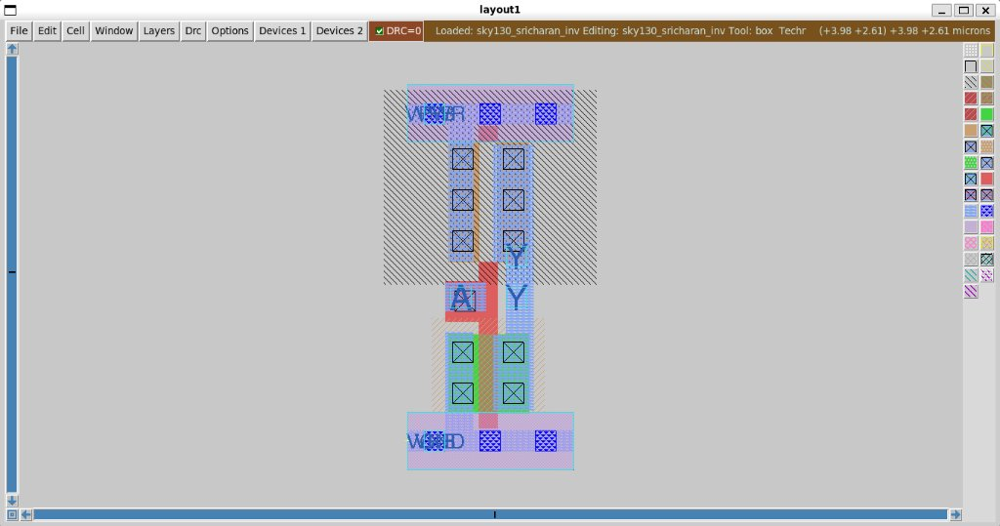
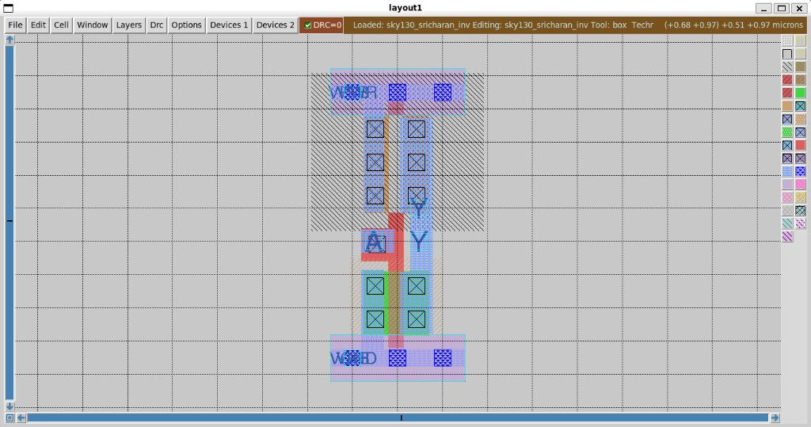
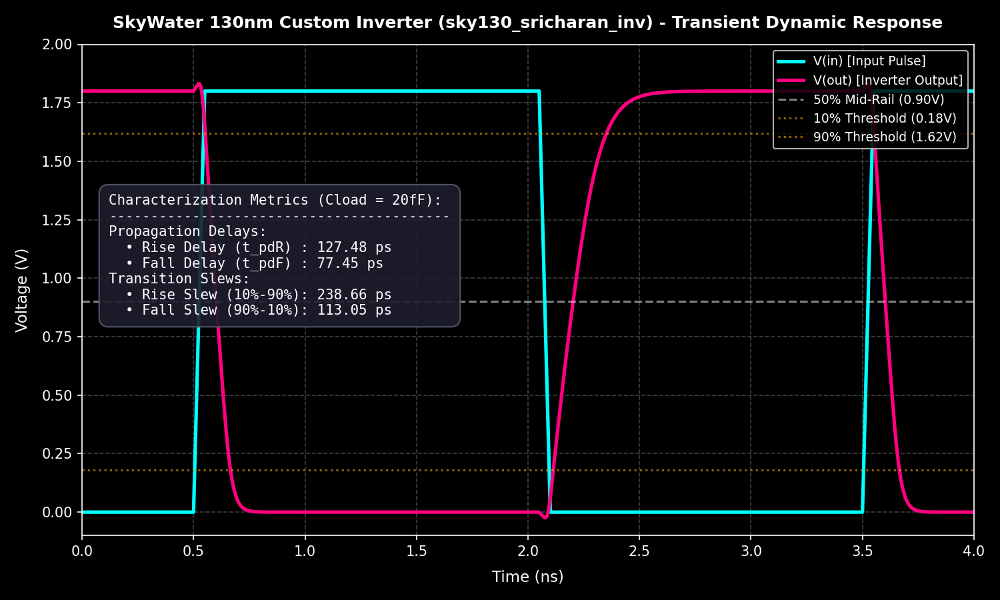
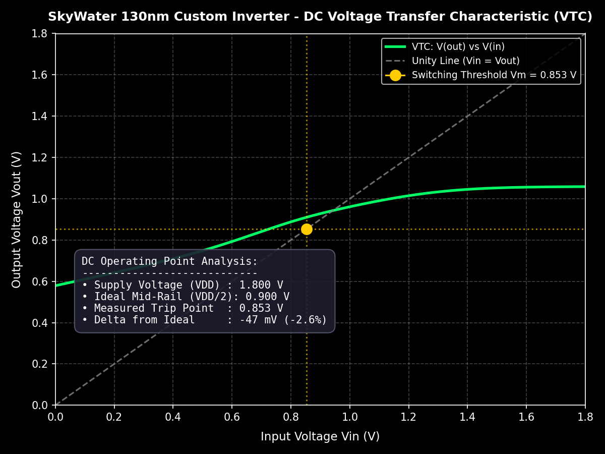

# Module 06: Custom Standard Cell Engineering, SPICE Characterization & LEF Generation


-brightgreen?style=for-the-badge)
-purple?style=for-the-badge)

---

## 1. Executive Summary

This module establishes an end-to-end custom standard cell library flow on the **SkyWater 130nm CMOS process node (`sky130A`)**. 

The custom inverter (`sky130_sricharan_inv`) is built adhering to the high-density standard cell architecture (`sky130_fd_sc_hd`). The cell is physically verified for design rules (DRC clean), parasitically extracted with sub-femtofarad precision, characterized for both dynamic AC transient switching and DC Voltage Transfer Characteristics (VTC) in `ngspice`, and exported as a production-ready Physical Library Abstract (`.lef`) formatted for automated placement and routing inside Claire Wolf's 32-bit RISC-V (`picorv32a`) core.

---

## 2. Standard Cell Architecture & Physical Grid Derivation

A fundamental requirement for automated placement and routing (PnR) engines (such as OpenDP and TritonRoute) is strict adherence to the foundry track highway system. The routing grid is governed by `tracks.info`:

$$\text{Horizontal Track Grid (li1 X)}: \text{Offset} = 0.23\,\mu\text{m}, \quad \text{Pitch} = 0.46\,\mu\text{m}$$
$$\text{Vertical Track Grid (li1 Y)}: \text{Offset} = 0.17\,\mu\text{m}, \quad \text{Pitch} = 0.34\,\mu\text{m}$$

### The 8-Track High-Density Unit Cell
The standard cell height is strictly bounded by 8 vertical track pitches:
$$\text{Cell Height} = 8 \times 0.34\,\mu\text{m} = 2.720\,\mu\text{m}$$
$$\text{Cell Width} = 3 \times 0.46\,\mu\text{m} = 1.380\,\mu\text{m}$$

### Mathematical Proof of Pin-on-Grid Alignment

The pin ports are positioned within the central routing corridor between the NMOS and PMOS diffusions:

$$\text{Track Position } Y(N) = 0.17\,\mu\text{m} + (N \times 0.34\,\mu\text{m})$$

| Pin Port | Layer | Physical Coordinates ($X_{min}, Y_{min}$) to ($X_{max}, Y_{max}$) | Geometric Center ($Y_{\text{center}}$) | Assigned Track | Theoretical Target | Grid Error |
| :---: | :---: | :---: | :---: | :---: | :---: | :---: |
| **Input `A`** | `li1` (Local Interconnect) | $(0.36\,\mu\text{m}, 1.11\,\mu\text{m}) \to (0.53\,\mu\text{m}, 1.27\,\mu\text{m})$ | **1.190 um** | Track 3 ($N=3$) | $0.17 + (3 \times 0.34) = \mathbf{1.190\,\mu\text{m}}$ | **0.000 um** |
| **Output `Y`** | `li1` (Local Interconnect) | $(0.82\,\mu\text{m}, 1.44\,\mu\text{m}) \to (0.99\,\mu\text{m}, 1.62\,\mu\text{m})$ | **1.530 um** | Track 4 ($N=4$) | $0.17 + (4 \times 0.34) = \mathbf{1.530\,\mu\text{m}}$ | **0.000 um** |

Pins `A` and `Y` are separated by exactly one track pitch ($\Delta Y = 0.340\,\mu\text{m}$), ensuring adjacent parallel routes cannot create DRC shorts.

<p align="center">
  
  
</p>

---

## 3. Transistor Sizing & Silicon Parasitic Extraction

The layout was extracted using Magic's computational geometry engine with zero parasitic capacitance filtering:
```tcl
extract all
ext2spice cthresh 0 rthresh 0
ext2spice
```

### Extracted Transistor Parameters (`sky130_sricharan_inv.spice`)
```spice
* SPICE3 Netlist extracted from sky130_sricharan_inv
.subckt sky130_sricharan_inv A VGND VNB VPB VPWR Y
X1000 Y A VPWR VPB sky130_fd_pr__pfet_01v8 w=1.00um l=0.15um ad=0.26p pd=2.52u as=0.26p ps=2.52u
X1001 Y A VGND VNB sky130_fd_pr__nfet_01v8 w=0.65um l=0.15um ad=0.17p pd=1.82u as=0.17p ps=1.82u

C0 VPWR VGND 0.01fF
C1 VPWR Y    0.26fF
C4 A    VGND 0.06fF
C5 A    Y    0.14fF   <-- Overlap Miller Capacitance
C7 VGND Y    0.20fF
C8 Y    VNB  0.17fF
C9 VPWR VNB  0.35fF
C10 VPB VNB  0.27fF
.ends
```

* **PMOS Sizing ($W_p = 1.00\,\mu\text{m}$):** Sized with 3 active vertical contact cuts.
* **NMOS Sizing ($W_n = 0.65\,\mu\text{m}$):** Sized with 2 active vertical contact cuts.
* **Sizing Ratio ($\frac{W_p}{W_n} \approx 1.54$):** Balanced specifically for High-Density standard cell track constraints while compensating for hole mobility degradation ($\mu_n \approx 2.5\mu_p$).

---

## 4. Dual-Domain SPICE Characterization Results

The cell was simulated in `ngspice` using the official BSIM4 SkyWater typical-typical (`tt`) process model corner (`sky130.lib.spice`) at $T = 27^\circ\text{C}$ with $V_{DD} = 1.80\,\text{V}$ and load capacitance $C_L = 20\,\text{fF}$.

### 4.1 AC Dynamic Switching & Propagation Delays

$$\text{Rise Delay } (t_{pdR}) = t(V_{out}=0.90\text{V}) - t(V_{in}=0.90\text{V})_{\text{falling}} = \mathbf{127.48\,\text{ps}}$$
$$\text{Fall Delay } (t_{pdF}) = t(V_{out}=0.90\text{V}) - t(V_{in}=0.90\text{V})_{\text{rising}} = \mathbf{77.45\,\text{ps}}$$
$$\text{Rise Transition Slew } (10\% \to 90\%) = \mathbf{238.66\,\text{ps}}$$
$$\text{Fall Transition Slew } (90\% \to 10\%) = \mathbf{113.05\,\text{ps}}$$

<p align="center">
  
</p>

### 4.2 DC Voltage Transfer Characteristic (VTC)

A high-resolution DC sweep ($0.0\,\text{V} \to 1.8\,\text{V}$ with $\Delta V = 5\,\text{mV}$) was executed to determine the switching threshold ($V_M$):

$$V_M = V_{in} \big|_{V_{in} = V_{out}} = \mathbf{0.853\,\text{V}}$$
$$\text{Ideal Mid-Rail Target} = \frac{V_{DD}}{2} = 0.900\,\text{V}$$
$$\text{Trip Point Offset} = 0.853\,\text{V} - 0.900\,\text{V} = \mathbf{-47\,\text{mV}} \quad (-2.6\%\text{ deviation from perfect mid-rail})$$

<p align="center">
  
</p>

---

## 5. Physical Library Abstract (`sky130_sricharan_inv.lef`)

Using Magic's LEF streaming engine, the cell abstract was exported:
```tcl
lef write sky130_sricharan_inv.lef
```

### Verified LEF Structure
```lef
VERSION 5.7 ;
  NOWIREEXTENSIONATPIN ON ;
  DIVIDERCHAR "/" ;
  BUSBITCHARS "[]" ;
MACRO sky130_sricharan_inv
  CLASS CORE ;
  FOREIGN sky130_sricharan_inv ;
  ORIGIN 0.000 0.000 ;
  SIZE 1.380 BY 2.720 ;
  SYMMETRY X Y R90 ;
  SITE unithd ;
  PIN A
    DIRECTION INPUT ;
    USE SIGNAL ;
    ANTENNAGATEAREA 0.247500 ;
    PORT
      LAYER li1 ;
        RECT 0.320 1.075 0.650 1.315 ;
    END
  END A
  PIN Y
    DIRECTION OUTPUT ;
    USE SIGNAL ;
    PORT
      LAYER li1 ;
        RECT 0.770 1.405 1.050 1.645 ;
    END
  END Y
  PIN VPWR
    DIRECTION INOUT ;
    USE POWER ;
    SHAPE ABUTMENT ;
  END VPWR
  PIN VGND
    DIRECTION INOUT ;
    USE GROUND ;
    SHAPE ABUTMENT ;
  END VGND
END sky130_sricharan_inv
END LIBRARY
```

---

## 6. Standard Cell Electrical & Physical Datasheet

| Parameter | Specification | Unit | Description / Condition |
| :--- | :--- | :--- | :--- |
| **Process Node** | SkyWater 130nm CMOS (`sky130A`) | - | 1-Poly, 5-Metal layer stack |
| **Library Standard** | High-Density (`hd`) | - | 8-Track row height standard |
| **Cell Dimensions** | $1.380 \times 2.720$ | $\mu\text{m}$ | $3 \times \text{Track}_X \times 8 \times \text{Track}_Y$ |
| **Cell Area** | $3.7536$ | $\mu\text{m}^2$ | Bounded layout core area |
| **Operating Voltage ($V_{DD}$)** | $1.80$ | $\text{V}$ | Nominal digital supply |
| **Nominal Temperature** | $27$ | $^\circ\text{C}$ | Typical operating condition |
| **Switching Threshold ($V_M$)** | $0.853$ | $\text{V}$ | DC point where $V_{in} = V_{out}$ |
| **Rise Delay ($t_{pdR}$)** | $127.48$ | $\text{ps}$ | $50\%\to 50\%$ input falling, $C_L = 20\,\text{fF}$ |
| **Fall Delay ($t_{pdF}$)** | $77.45$ | $\text{ps}$ | $50\%\to 50\%$ input rising, $C_L = 20\,\text{fF}$ |
| **Rise Transition ($t_r$)** | $238.66$ | $\text{ps}$ | $10\%\to 90\%$ output transition |
| **Fall Transition ($t_f$)** | $113.05$ | $\text{ps}$ | $90\%\to 10\%$ output transition |
| **Static Leakage ($I_{leak}$)** | $1.916$ | $\text{pA}$ | Quiescent state off-current |
| **DRC Violations** | $0$ | violations | Full foundry Design Rule Clean |

---

*Authored by: **Sri Charan Aitharaju***  
*Digital ASIC Design & Implementation Engineer*
